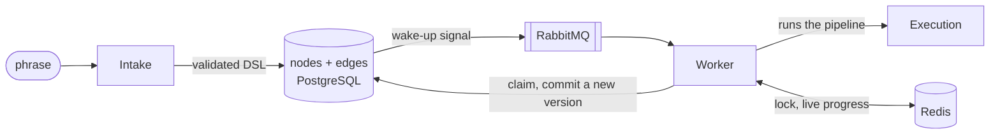
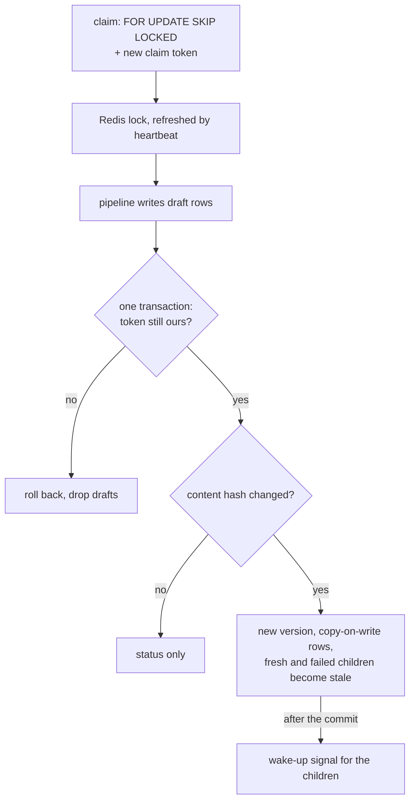

# Living Tables

[](https://github.com/AstrologOo/living-tables/actions/workflows/ci.yml)

A backend for a graph of tables that keep themselves up to date. You connect data sources (an HTTP API, a
webhook), describe the table you want in words, and an LLM turns the phrase into a declarative JSON pipeline.
The system runs it, and when source data or a node's config changes, it recomputes the affected downstream nodes.

Laravel 13 (PHP 8.4) · PostgreSQL · RabbitMQ · Redis · Gemini behind an interface. API only, apart from a
read-only graph viewer (`/graph`) and Swagger UI (`/docs`).

## Example: phrase → DSL → table

Phrase: *"From the shop API, show products cheaper than 100 with price including 20% tax, cheapest first."*

The model fills in a JSON schema; it never writes code:

```json
[
  {"op": "fetch", "url": "https://shop.example/api/products", "format": "json"},
  {"op": "extract", "path": "$.products[*]", "row_key_field": "sku"},
  {"op": "filter", "field": "price", "cmp": "<", "value": 100},
  {"op": "map", "fields": {"sku": "sku", "name": "name", "price_with_tax": {"expr": "price * 1.2"}}},
  {"op": "sort", "field": "price_with_tax", "order": "asc"}
]
```

For a source returning Keyboard (45), Monitor (210) and Mouse (20):

| sku | name | price_with_tax |
|-----|----------|----|
| C3 | Mouse | 24 |
| A1 | Keyboard | 54 |

The flow is `POST /api/nodes` → `preview` (phrase or DSL, saves nothing) → `apply`. Column names and types are
derived from each result, so views, filters and sorting work after the first run. Confirming a schema
(`POST /api/nodes/{node}/columns-schema`) fixes them and turns on schema-drift checks against it.

## Operations

The set is closed. A pipeline is a list of steps that starts with a source.

| Operation | Fields (`?` is optional) | What it does |
|-----------|--------------------------|--------------|
| `fetch` | `url`, `format`, `pagination?` | source: an HTTP request for `json`, `csv` or `html`; pagination is for `json` |
| `parent` | `node` | source: the current data of another node |
| `webhook_source` | | source: the latest webhook payload; accepted by `apply`, never generated from a phrase |
| `document` | `file_ref` | source: the text of a file (not working yet, see limitations) |
| `extract` | `path`, `row_key_field?` | turns raw data into rows: a JSONPath, or a CSS selector for `html` |
| `filter` | `field`, `cmp`, `value` | keeps matching rows: `==`, `!=`, `>`, `<`, `>=`, `<=`, `contains` |
| `map` | `fields` | selects, renames or computes columns (`symfony/expression-language`) |
| `merge` | `with`, `on`, `how?` | `inner` (default) or `left` join with another node on one column |
| `llm` | `instruction`, `input_fields`, `output_field`, `model_tier` | fills a column row by row with a model; answers are cached, a skipped row stays null until a later run |
| `sort` | `field`, `order?` | trailing only: ordering of the default view |
| `unique` | `field` | trailing only: deduplication in the default view |
| `limit` | `count` | trailing only: row limit of the default view |

Trailing `sort`, `unique` and `limit` steps are not computed: they are saved as the node's default view and applied
on read. Rollback restores them along with the computed steps. The exact schema is [dsl.schema.json](app/Modules/Intake/schema/dsl.schema.json).

When reading rows, views and aggregates, a value in a number column that isn't a number (or is 1e100 or more) counts
as null: it matches no comparison, sorts last and is left out of aggregates. Filtering a number column by something
that isn't a number answers 422; `contains` compares text. Numbers are written as in JSON, so `007` and `+5` are not
numbers.

A new view is checked the same way: an unknown column, such a value or a malformed filter answers 422 and nothing is
saved. A filter condition is a value (equality) or `{"cmp": ..., "value": ...}`, and is saved in the second form.

## Architecture

A modular monolith in `app/Modules`, run as two process types from one codebase: the API and queue workers.



| Module | Owns | May depend on |
|--------|------|---------------|
| `Graph` | nodes, edges, versions, rows, statuses, invalidation | Execution's contracts and payloads, Shared, Models |
| `Execution` | the DSL interpreter: rows in, rows out | its own contracts, Shared. **Never `Graph`** |
| `Intake` | phrase → valid DSL, preview | Graph, Execution, Shared |
| `Shared` | ports (`LlmProvider`, `DocumentParser`, `BlobStorage`), HTTP safety | nothing outside itself |
| `Shared/Adapters` | vendor code | Shared; only `app/Providers` may use it |

[deptrac](deptrac.yaml) enforces this in CI. `app/Http` may use Graph, Intake, Shared, Models, `app/Support`
and Execution's exceptions, but no pipeline types. `app/Console` (which hosts the worker) is where Graph and
Execution meet: `Execution` reaches parent data only through ports that `Graph` implements. The one skipped
violation is a dev command that reads a vendor adapter's token usage.

## Invariants

1. A node is computed only when all its parents are `fresh`.
2. Results are never overwritten: a change appends a new version, sharing unchanged rows.
3. Data, version and status are committed in one transaction.
4. `Execution` never imports from `Graph`.
5. Columns are referenced by internal `col_id`, not by raw external names.
6. Vendor names appear only in `Shared/Adapters`, config and `.env`.

Statuses are `fresh`, `stale`, `processing`, `failed`, `schema_drift`. Children of a `failed` node keep their
last good version. A new version of a parent gives a `failed` child another run. `schema_drift` (a used source field
vanished or changed type) waits for a human, except on a webhook source, which is checked again on its next payload.

## How recomputation works



- **Ownership.** The claim token in the database decides who may write. Every worker write is conditional on it.
  A config change by `apply` or rollback clears it, which cancels the run in progress.
- **Liveness.** The Redis lock only shows that somebody is still working. Every minute,
  `graph:recover-stuck-nodes` takes back `processing` nodes without a lock and counts each as a retryable
  failure. Runs have a 30-minute budget.
- **Commit.** Rows are locked in one order: parents `FOR SHARE`, the node `FOR UPDATE`, then, for a new version,
  its children `FOR NO KEY UPDATE` (ancestors first within a group), so concurrent commits wait for each other
  instead of deadlocking. If a parent moved on during the run, the result is committed and the node is left `stale`.
- **Cascade.** The transaction that appends a version also marks the node's `fresh` and `failed` children `stale`.
  No message carries it, so a broker outage or a crash after the commit loses nothing.
- **Webhook revision.** A payload arriving during a run does not cancel it; it bumps `data_revision`, and the
  commit leaves the node `stale` so the new data is processed next.
- **Failures.** Permanent errors (blocked address, DSL or expression error, oversized response, source 4xx
  except 429, limits) go straight to `failed`. Others (connection, timeout, 429, 5xx, LLM) retry after 30 s and
  then 1 min; the third failure in a row is `failed`. An interrupted run counts too.
  A successful run, a config change by `apply` or rollback, or resolving a schema drift resets the counter.
  Re-applying the same config restarts a `failed` node. A parent's new version does not reset it: a child that
  failed three times gets one more run, and its next failure is `failed` again.
- **Queue messages** are wake-up signals, not jobs: a worker takes whichever node is ready. It also sweeps
  every few seconds, so a lost message only adds that delay.

## Security

- **SSRF.** Every redirect hop resolves the host, rejects private, link-local, multicast, reserved and
  IPv6-transition ranges, and pins the connection to the checked IP (`CURLOPT_RESOLVE`). Proxies are disabled.
  A fetch has one 30-second budget across redirects and a 10 MiB cap on the decompressed body.
- **Webhooks.** `X-Webhook-Signature` must be the hex HMAC-SHA256 of the raw body, keyed by the node's secret.
- **Parent data.** A pipeline may read (`parent`, `merge`) only its node's declared parents, owned by the same user.
  `apply` and rollback reject anything else, and the worker checks again before reading.
- **Auth.** Sanctum bearer tokens with a 30-day lifetime. Login: 5 attempts per minute per email + IP and 20 per
  IP. Registration: 5 per minute per IP. Other users' resources answer 404.
- **Error texts.** Clients see messages only for an allow-list of errors about their own DSL, data, limits and
  source. Everything else is generic; details go to the log.

## LLM quality

Tests never call a real model, so quality is measured by hand with a `GEMINI_API_KEY`:

```bash
docker compose exec app php artisan execution:llm-golden-set   # the llm operation
docker compose exec app php artisan intake:iterate-phrases     # phrase → valid DSL rate
```

The first runs [40 labelled reviews](app/Modules/Execution/dev/llm-golden-set.json) (sentiment) through the real
`llm` operation, bypassing the cache, and writes a match-rate report to `storage/app`. It tracks drift when the
model changes; it has no pass threshold and says nothing about DSL correctness.

## Running locally

```bash
cp .env.example .env
# In .env set REVERB_APP_ID, REVERB_APP_KEY, REVERB_APP_SECRET to any random strings for realtime pushes,
# and GEMINI_API_KEY to use phrases and llm steps (see below).
docker compose build
docker compose run --rm app composer install
docker compose run --rm app php artisan key:generate
docker compose run --rm app php artisan migrate
docker compose up -d
```

The API is on `http://localhost:8080`, RabbitMQ's UI on `:15672` (`app`/`secret`), Reverb on `:8081`.

### Ports and a second copy

Compose reads these from `.env`: `FORWARD_APP_PORT` (8080), `FORWARD_REVERB_PORT` (8081), `FORWARD_DB_PORT` (5432),
`FORWARD_REDIS_PORT` (6379), `FORWARD_RABBITMQ_PORT` (5672), `FORWARD_RABBITMQ_UI_PORT` (15672) and `APP_IMAGE`
(`graph-backend-app:local`). To run two copies side by side, give the second its own ports, `APP_IMAGE` and
`COMPOSE_PROJECT_NAME`. A new app port also goes into `APP_URL`, a new Reverb port into `VITE_REVERB_PORT`.

### LLM provider

Phrases and `llm` steps need a Gemini API key from a project with billing enabled, in `GEMINI_API_KEY`. The model
of each tier is set in `.env` (`GEMINI_MODEL_CHEAP`, `_STANDARD`, `_SMART`); replace a version when Google retires
it. When the provider can't answer a phrase, the API responds 503.

`.env.example` sets `GEMINI_THINKING_LEVEL=low`; copy that line into an older `.env`. Without it the standard and
smart models think at `medium`, which is slower, costs more (thinking tokens are billed as output) and comes closer
to the 30-second request timeout. The level applies to every tier, and the default smart model rejects `minimal`.

### Graph viewer

Open `http://localhost:8080/graph`, paste an API token and press "Use token". Registering or logging in returns one:

```bash
curl -X POST http://localhost:8080/api/register -H 'Content-Type: application/json' -H 'Accept: application/json' \
  -d '{"name": "Me", "email": "me@example.com", "password": "choose-a-password"}'
```

The token is kept in the browser's local storage until you press "Forget".

### Schema drift

A node in `schema_drift` waits for you, with one exception: any new payload queues a webhook source again. If the
payload has the field, the node becomes `fresh` without anyone's action; if not, it drifts again and sends another
notification. For other nodes, either the field is back, or you remove it from the confirmed schema:

```bash
docker compose exec app php artisan graph:resolve-drift {node} --returned
docker compose exec app php artisan graph:resolve-drift {node} --remove={col_id}
```

Applying a new config also queues the node again.

### After pulling changes

```bash
docker compose build
docker compose run --rm app composer install
docker compose up -d
docker compose exec app php artisan migrate
docker compose exec app php artisan rabbitmq:setup-topology   # upgrades queues, deletes ones no longer used
docker compose restart worker scheduler
```

### Tests

```bash
docker compose exec app composer test    # sqlite in memory

docker compose exec postgres createdb -U root graph_test   # once
docker compose exec app composer test:pgsql                # needed for the row-lock tests
docker compose exec app ./vendor/bin/pint --test
docker compose exec app composer deptrac
```

The tests use a RabbitMQ vhost of their own, `living_tables_test`, and create it through the management API
(port `15672`, `RABBITMQ_MANAGEMENT_PORT` to change it; the user needs the `administrator` tag), so a running
worker doesn't compete for their messages. A `RABBITMQ_VHOST` set in the environment is used instead.

Tests refuse to run against a server database whose name does not end in `_test`.
They log nowhere, so the application's `laravel.log` stays clean.

## Deployment notes

The compose file is for development (default passwords, debug on). For anything else:

- An outbound HTTP proxy is not supported for `fetch`: it connects directly to the checked address.
- Behind a load balancer, configure trusted proxies, or every client shares one IP for rate limits.
- API tokens expire after 30 days (`SANCTUM_TOKEN_EXPIRATION_MINUTES`); there is no refresh.
- The SSRF guard's DNS lookup is not bounded by the fetch time budget.
- Set `CORS_ALLOWED_ORIGINS`; run exactly one `scheduler`.

## Known limitations

- Generated DSL can be valid and still wrong. Only a step that empties its input is detected and retried.
- `node_rows.data` has no index: filters, sorts and `merge` scan a node's rows, `merge` once per batch.
- Old versions are never pruned, so storage only grows.
- `document` does not work yet: there is no parser or file storage adapter. Gemini is the only LLM adapter.
- Realtime pushes are best-effort: while Reverb is unavailable they are dropped (and logged), and each one can
  hold the worker for up to 5 s.
- Stopping a worker waits only for Docker's timeout; a longer run is killed and later recovered, which counts
  as a failure: three such stops in a row leave the node `failed`.
- Webhooks have no replay protection or rate limit, and only the latest payload is kept.
- Schema drift is resolved by an artisan command or by applying a new config; per-user limits have no API.
- A fetch is pinned to one address, so there is no failover between a host's addresses.
- No email verification or password reset.
- A source field that vanishes from a `map` expression only (`qty * 2`) leaves the node `failed`, not
  `schema_drift`.
- Without a sort, rows changed by a recompute move to the end of the table.
- A new node without a config is `fresh` at once, with an empty table.
- A view holds one condition per column, so it can't express a range such as "price from 5 to 10"; a phrase that
  needs two answers 422.

## Documentation

The API contract is [openapi.yaml](openapi.yaml).

## License

[AGPL-3.0-or-later](LICENSE).
